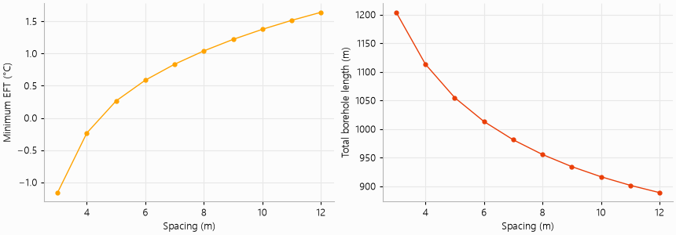

# Spacing between boreholes

Boreholes interfere less as they move apart, but spacing costs land. This example keeps the twelve
boreholes of the office building of `demo_project.py` on a 4 × 3 grid and varies their spacing from
3 to 12 m. Each field is simulated over 25 years and sized, and the script plots the coldest
entering fluid temperature and the total length required.

The script is `examples/borehole_spacing.py`:

```{literalinclude} ../../examples/borehole_spacing.py
:language: python
:linenos:
```


