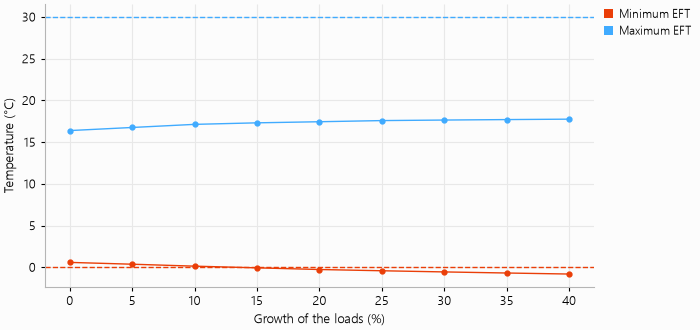

# A growing building

How much room does the field have if the building is extended? This example scales every demand of
the office building of `demo_project.py` by up to 40 %, simulates each case over 25 years with
`ga.run_many`, and plots the coldest and the warmest entering fluid temperature. The dashed lines
are the temperature limits of the heat pumps. The coldest hour crosses the heating limit of 0 °C at
about 15 % of growth.

The script is `examples/building_growth.py`:

```{literalinclude} ../../examples/building_growth.py
:language: python
:linenos:
```


