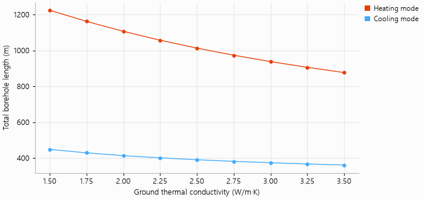

# Uncertainty of the ground conductivity

A thermal response test gives the ground thermal conductivity with some uncertainty, and the length
of the field depends on it. This example sizes the office building of `demo_project.py` for
conductivities from 1.5 to 3.5 W/m·K, with `ga.sweep`, and plots the total borehole length each
mode requires. Heating governs over the whole range.

The script is `examples/conductivity_uncertainty.py`:

```{literalinclude} ../../examples/conductivity_uncertainty.py
:language: python
:linenos:
```


