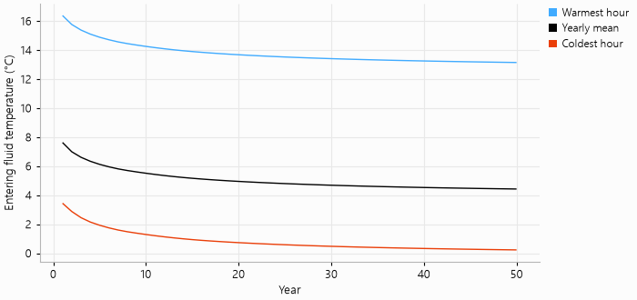

# Long-term evolution of the field

A heating-dominated building slowly cools the ground around its field. This example simulates the
office building of `demo_project.py` over 50 years and plots, for each year, the coldest hour, the
warmest hour and the yearly mean of the entering fluid temperature. The ground cools year after
year, quickly at first and more slowly afterwards.

The script is `examples/field_ageing.py`:

```{literalinclude} ../../examples/field_ageing.py
:language: python
:linenos:
```


