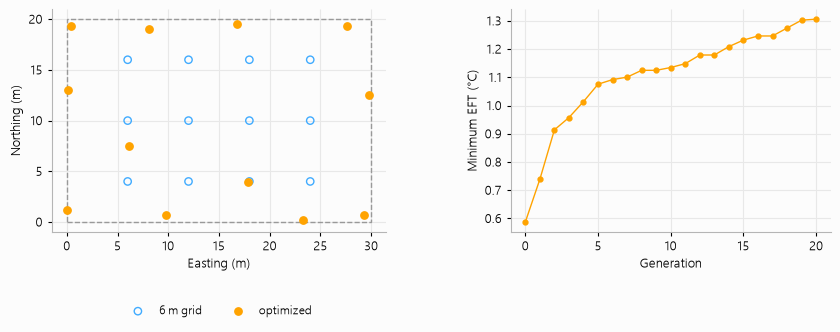

# Optimizing the borehole positions

The positions of the boreholes are free: `Coordinates.from_points` takes any list of (x, y) heads,
not only a regular grid. This example places the twelve boreholes of the office building of
`demo_project.py` anywhere in a 30 × 20 m lot, at least 4 m apart, so that the coldest entering
fluid temperature of a 25-year simulation is as warm as possible.

The search is a plain evolutionary one. Each generation perturbs the best layout found so far in
eight ways, and `run_many` simulates the eight candidates together; when none of them is better,
the step shrinks. Starting from the 6 m grid (0.59 °C), twenty generations, 160 simulations and
about half a minute bring the coldest hour to 1.31 °C. The boreholes move to the edge of the lot,
where they interfere the least.

The script is `examples/field_layout_optimization.py`:

```{literalinclude} ../../examples/field_layout_optimization.py
:language: python
:linenos:
```


